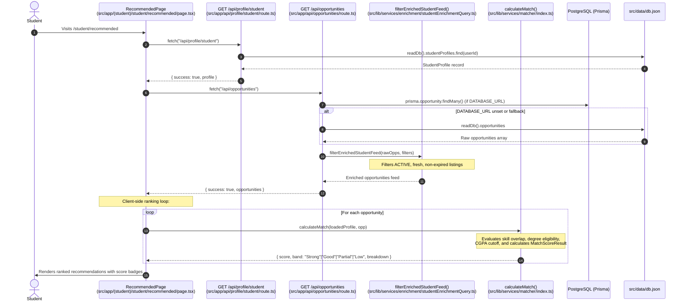
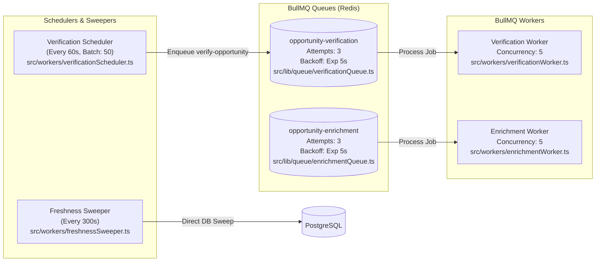
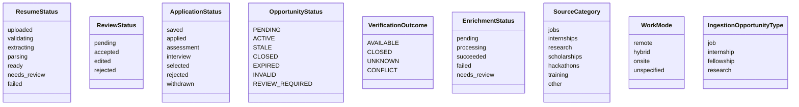

# CareerLaunch Architecture & Opportunity Data Audit

> **Document Version:** 1.0.0 (Phase 0 Audit)  
> **Audited Repository:** `bhuumika07/careerLaunch`  
> **Date:** November 16, 2026  
> **Invariant:** Every claim in this document cites a precise repository file path and line number.

---

## Table of Contents
1. [Architecture Diagram & Component Topology](#1-architecture-diagram--component-topology)
2. [Task 1: Authenticated Student ID Resolution](#2-task-1-authenticated-student-id-resolution)
3. [Task 2: Recommendation Page End-to-End Trace](#3-task-2-recommendation-page-end-to-end-trace)
4. [Task 3: Resume Pipeline Trace](#4-task-3-resume-pipeline-trace)
5. [Task 4: API & Service Inventory & Queue Conventions](#5-task-4-api--service-inventory--queue-conventions)
6. [Task 5: Prisma Migration History & Enums Summary](#6-task-5-prisma-migration-history--enums-summary)
7. [Chunk 0.2: Opportunity Model & Consumer Audit](#7-chunk-02-opportunity-model--consumer-audit)
8. [Chunk 0.2: Synthetic Data & Fabrication Audit](#8-chunk-02-synthetic-data--fabrication-audit)
9. [Chunk 0.2: Existing Rows & Impact Count](#9-chunk-02-existing-rows--impact-count)
10. [Chunk 0.2: Canonical Model Recommendation & Migration Plan](#10-chunk-02-canonical-model-recommendation--migration-plan)

---

## 1. Architecture Diagram & Component Topology

```mermaid
flowchart TD
    subgraph ClientLayer ["Client Layer (Next.js 16 App Router)"]
        UI_Opps["Opportunities Page<br/>src/app/opportunities/page.tsx"]
        UI_Rec["Recommended Page<br/>src/app/(student)/student/recommended/page.tsx"]
        UI_Resume["Resume Manager<br/>src/app/(student)/student/resume/page.tsx"]
        UI_Apps["Applications Tracker<br/>src/app/(student)/student/applications/page.tsx"]
    end

    subgraph MiddlewareAuth ["Edge & Auth Guards"]
        MW["Edge Middleware<br/>src/middleware.ts"]
        Guard["Auth Guards (requireRole, requireAuth)<br/>src/lib/auth-guard.ts"]
        SessionStore["Session Manager (cl_session)<br/>src/lib/session.ts"]
    end

    subgraph APILayer ["Next.js Route Handlers (src/app/api/)"]
        API_Opps["/api/opportunities<br/>src/app/api/opportunities/route.ts"]
        API_Prof["/api/profile/student<br/>src/app/api/profile/student/route.ts"]
        API_Resumes["/api/resumes & /api/resume<br/>src/app/api/resumes/route.ts"]
        API_Apps["/api/student/applications<br/>src/app/api/student/applications/route.ts"]
    end

    subgraph ServiceLayer ["Service & Business Logic Layer"]
        EnrichQuery["Student Feed Query Engine<br/>src/lib/services/enrichment/studentEnrichmentQuery.ts"]
        Matcher["Deterministic Matcher<br/>src/lib/services/matcher/index.ts"]
        ResumeService["Resume Service & Storage<br/>src/server/services/resume/resumeService.ts"]
        LifecycleMgr["Opportunity Lifecycle Manager<br/>src/lib/services/verification/lifecycleManager.ts"]
        EnrichService["Opportunity Enrichment Service<br/>src/lib/services/enrichment/enrichmentService.ts"]
    end

    subgraph QueueWorkers ["Background Asynchronous Layer (BullMQ & Redis)"]
        Q_Verif["verificationQueue ('opportunity-verification')<br/>src/lib/queue/verificationQueue.ts"]
        Q_Enrich["enrichmentQueue ('opportunity-enrichment')<br/>src/lib/queue/enrichmentQueue.ts"]
        W_Verif["Verification Worker<br/>src/workers/verificationWorker.ts"]
        W_Sched["Verification Scheduler (60s cron)<br/>src/workers/verificationScheduler.ts"]
        W_Sweep["Freshness Sweeper (5m cron)<br/>src/workers/freshnessSweeper.ts"]
        W_Enrich["Enrichment Worker<br/>src/workers/enrichmentWorker.ts"]
    end

    subgraph StorageLayer ["Persistence Layer"]
        PrismaPostgres["PostgreSQL via PrismaClient<br/>prisma/schema.prisma & src/lib/prisma.ts"]
        JSONStore["File-backed Store (Development/Fallback)<br/>src/lib/db.ts & src/data/db.json"]
    end

    UI_Opps --> MW --> API_Opps
    UI_Rec --> MW --> API_Prof
    UI_Rec --> MW --> API_Opps
    UI_Resume --> MW --> API_Resumes
    UI_Apps --> MW --> API_Apps

    API_Opps --> Guard --> EnrichQuery
    API_Prof --> Guard --> JSONStore
    API_Apps --> Guard --> JSONStore
    API_Resumes --> Guard --> ResumeService

    EnrichQuery --> PrismaPostgres
    EnrichQuery -.->|Fallback if DATABASE_URL unset| JSONStore

    W_Sched --> Q_Verif --> W_Verif --> LifecycleMgr --> PrismaPostgres
    W_Sweep --> PrismaPostgres
    W_Enrich --> Q_Enrich --> EnrichService --> PrismaPostgres
```

---

## 2. Task 1: Authenticated Student ID Resolution

### How the Session and Student Identity are Resolved
1. **Cookie & Header Extraction (`src/lib/auth-guard.ts` lines 26–51):**
   - The helper `extractSessionId(req)` inspects incoming requests in 3 prioritized steps:
     1. `Authorization` header with format `Bearer <sessionId>`.
     2. NextRequest cookies for cookie name `cl_session` (`SESSION_COOKIE_NAME`).
     3. Next.js `cookies()` header store fallback.
2. **Session Verification (`src/lib/auth-guard.ts` lines 57–85 & `src/lib/session.ts` lines 49–63):**
   - `requireAuth(req)` invokes `getSessionFromDb(sessionId)`.
   - `getSessionFromDb` retrieves the session from the JSON data store (`db.sessions` in `src/data/db.json`).
   - Validates that `session.expiresAt > Date.now()`. Expired sessions are pruned and return `null`.
   - Resolves the associated user by ID (`db.users.find(u => u.id === session.userId)`).
   - Validates user account status (rejects `deactivated` and `suspended` accounts with `AuthError(403)`).
3. **Role Enforcement (`src/lib/auth-guard.ts` lines 92–115):**
   - `requireRole(allowedRoles, req)` checks `auth.user.role`.
   - Rejects non-matching roles with `AuthError(403)`.
   - Note: Users with `role === "admin"` are granted superuser bypass (`src/lib/auth-guard.ts` lines 99–100).
4. **Edge Middleware Pre-Routing (`src/middleware.ts` lines 10–53):**
   - `middleware(request)` checks routes matching `/student/:path*`, `/admin/:path*`, `/onboarding/:path*`, `/settings/:path*`.
   - Verifies the presence of `cl_session` cookie; redirects unauthenticated requests to `/login?redirect=<pathname>`.
   - Inspects companion cookie `cl_role` set by `createSession()` (`src/lib/session.ts` lines 38–44) to redirect cross-role access attempts.
5. **Critical Architecture Observation:**
   - The active authentication system is currently backed by `src/lib/session.ts` and `src/lib/db.ts` (`src/data/db.json`), while `prisma/schema.prisma` lines 371–379 defines a separate Postgres `model User`.
   - In student API route handlers (e.g. `src/app/api/profile/student/route.ts` line 8, `src/app/api/resumes/route.ts` line 44, `src/app/api/student/applications/route.ts` line 8), the authenticated student ID is strictly accessed via `auth.user.id` from `requireRole(["student"], req)`. Client-supplied user/student IDs in request bodies or query params are ignored.

---

## 3. Task 2: Recommendation Page End-to-End Trace

### End-to-End Call Chain: Component → API → Service → DB

### File & Line Breakdown:
1. **Frontend Component:** `src/app/(student)/student/recommended/page.tsx`
   - Lines 38–74: `React.useEffect` issues `Promise.all([fetch("/api/profile/student"), fetch("/api/opportunities")])`.
   - Lines 56–62: Iterates opportunities and calls `calculateMatch(loadedProfile, opp)`.
   - Lines 79–87: Sorts ranked opportunities by match score (`b.match.score - a.match.score`) or deadline.
2. **Profile API Route:** `src/app/api/profile/student/route.ts`
   - Line 8: Authenticates student via `requireRole(["student"], req)`.
   - Lines 9–25: Queries `db.studentProfiles.find(p => p.userId === user.id)` from `src/data/db.json` via `src/lib/db.ts`.
3. **Opportunity API Route:** `src/app/api/opportunities/route.ts`
   - Lines 45–54: Attempts Prisma query `(prisma.opportunity as any).findMany({ include: { source: true, opportunityEnrichment: true } })`.
   - Lines 55–58: Falls back to `readDb().opportunities` from `src/data/db.json` when Prisma is not configured.
   - Lines 70–86: Calls `filterEnrichedStudentFeed(rawOpps, filters)` in `src/lib/services/enrichment/studentEnrichmentQuery.ts`.
4. **Matching Service:** `src/lib/services/matcher/index.ts`
   - Lines 126–220: Function `calculateMatch(profile: StudentProfile, opp: Opportunity)`:
     - Hard eligibility gates: Degree levels, graduation year, minimum CGPA (`lines 135–170`).
     - Required skills scoring: 50% weight (`lines 175–190`).
     - Preferred skills scoring: 25% weight (`lines 191–205`).
     - Work mode and category preference: 25% weight (`lines 206–215`).
     - Returns `MatchScoreResult` with score 0–100 and band: `Strong` (>=80), `Good` (>=60), `Partial` (>=40), `Low` (<40).
5. **Secondary Career Discovery Engine:** `src/app/api/career-discovery/route.ts` & `src/lib/services/career-recommender/index.ts`
   - Lines 81–84: Calls `generateCareerRecommendations(fullAnswers)` to suggest high-level career paths (e.g. Frontend Engineer, Cloud Solutions Architect). Stores results in `db.careerDiscoveryResponses` (`src/data/db.json`).

---

## 4. Task 3: Resume Pipeline Trace

### Duality in Current Resume Handling
The audit reveals two distinct resume handling pathways currently present in the codebase:

```mermaid
flowchart TD
    subgraph PipelineA ["Pipeline A: Enterprise Prisma & BullMQ (src/app/api/resumes/route.ts)"]
        UploadA["POST /api/resumes (multipart/form-data)"]
        ByteCheck["Validate Magic Bytes (%PDF, PK) & Size <= 5MB<br/>src/app/api/resumes/route.ts:14-24"]
        StoreFile["storeResumeFile(buffer, filename, mimetype)<br/>src/lib/services/resume/storageService.ts"]
        CreatePrisma["prisma.resume.create & prisma.resumeVersion.create<br/>status: 'uploaded'<br/>src/app/api/resumes/route.ts:80-111"]
        EnqueueJob["enqueueResumeExtraction(version.id)<br/>src/lib/jobs/resumeExtractionQueue (unimplemented stub)"]
        AuditSync["logProfileSync(studentId, versionId, fields)<br/>prisma.profileSyncLog.create<br/>src/server/services/resume/resumeService.ts:134"]
        PrismaModelReview["model ParsedFieldReview<br/>prisma/schema.prisma:61-70<br/>(Defined in schema, awaiting pipeline wiring)"]

        UploadA --> ByteCheck --> StoreFile --> CreatePrisma --> EnqueueJob
        CreatePrisma -.-> PrismaModelReview
        PrismaModelReview -.-> AuditSync
    end

    subgraph PipelineB ["Pipeline B: Fast In-Memory Parser (src/app/api/resume/route.ts)"]
        UploadB["POST /api/resume (JSON with rawText)"]
        Parser["extractResumeSections(rawText, fileName)<br/>src/lib/services/resume-parser/index.ts:55"]
        QualityCheck["checkResumeQuality() & generateImprovementSuggestions()<br/>src/lib/services/resume-parser/index.ts"]
        SaveJSON["db.resumes.push(newResume)<br/>src/data/db.json<br/>src/app/api/resume/route.ts:86"]
        ImportRoute["POST /api/resume/[id]/import<br/>src/app/api/resume/[id]/import/route.ts"]
        MergeProf["Merge approvedFieldIds into db.studentProfiles<br/>src/app/api/resume/[id]/import/route.ts:47-90"]

        UploadB --> Parser --> QualityCheck --> SaveJSON
        SaveJSON --> ImportRoute --> MergeProf
    end
```

### Trace Details:
1. **Pipeline A (Prisma & Storage):**
   - **Endpoint:** `src/app/api/resumes/route.ts` lines 40–117.
   - **Authentication:** Scoped to `auth.user.id` via `requireRole(["student"])`.
   - **File Validation:** Checks binary magic bytes: PDF (`%PDF` / `0x25 0x50 0x44 0x46`), DOCX (`PK\x03\x04` / `0x50 0x4b 0x03 0x04`). Size capped at 5MB (`lines 55–75`).
   - **File Persistence:** Stored via `storeResumeFile()` in `src/lib/services/resume/storageService.ts` to `storage/resumes/<hash>`.
   - **Database Records:** Inserts `prisma.resume` (`studentId, title`) and `prisma.resumeVersion` with `status: "uploaded"`, SHA-256 checksum, and version numbering (`lines 80–111`).
   - **Service Methods (`src/server/services/resume/resumeService.ts`):**
     - `createResume()` (lines 11–19)
     - `uploadResumeVersion()` (lines 44–79)
     - `activateVersion()` (lines 82–101)
     - `logProfileSync(studentId, resumeVersionId, fieldsApplied)` (lines 134–146) writes directly to `prisma.profileSyncLog`.
   - **Missing Link:** Line 114 imports `enqueueResumeExtraction` from `src/lib/jobs/resumeExtractionQueue`, but `src/lib/jobs/resumeExtractionQueue.ts` does not yet exist.
2. **Pipeline B (Interactive Parser & Field Import):**
   - **Endpoint:** `src/app/api/resume/route.ts` lines 28–96.
   - **Parser Service:** `src/lib/services/resume-parser/index.ts` lines 55–120 extracts skills, projects, and educational qualifications via regex heuristics.
   - **Quality Assessment:** Computes impact score and bullet point quality (`lines 125–210`).
   - **Import Route:** `src/app/api/resume/[id]/import/route.ts` lines 6–101 receives `approvedFieldIds` (e.g. `diff_skill_React`, `diff_proj_1`, `diff_cgpa`) and merges approved values into `db.studentProfiles`.
   - **Gap:** Pipeline B writes to `src/data/db.json` and does NOT write an audit log to `prisma.profileSyncLog` or create `prisma.parsedFieldReview` rows.

---

## 5. Task 4: API & Service Inventory & Queue Conventions

### Complete API Route Inventory (`src/app/api/`)

| Route Path | Method | Auth Required | Backing Store | Description | File Path |
|---|---|---|---|---|---|
| `/api/auth/register` | POST | None | JSON DB | Student / user account registration | `src/app/api/auth/register/route.ts` |
| `/api/auth/login` | POST | None | JSON DB | Email/password login & session cookie creation | `src/app/api/auth/login/route.ts` |
| `/api/auth/logout` | POST | Authenticated | JSON DB | Terminates active session cookie | `src/app/api/auth/logout/route.ts` |
| `/api/auth/me` | GET | Authenticated | JSON DB | Returns session user profile | `src/app/api/auth/me/route.ts` |
| `/api/auth/forgot-password` | POST | None | JSON DB | Password reset token generation | `src/app/api/auth/forgot-password/route.ts` |
| `/api/auth/reset-password` | POST | None | JSON DB | Updates password hash via token | `src/app/api/auth/reset-password/route.ts` |
| `/api/auth/verify-email` | POST | None | JSON DB | Confirms email verification token | `src/app/api/auth/verify-email/route.ts` |
| `/api/opportunities` | GET, POST | GET: Public/Student POST: Admin | Prisma + JSON DB Fallback | Search & filter opportunities feed; Admin create | `src/app/api/opportunities/route.ts` |
| `/api/opportunities/[id]` | GET, PUT, DELETE | GET: Public PUT/DEL: Admin | JSON DB | Opportunity details, update, and delete | `src/app/api/opportunities/[id]/route.ts` |
| `/api/opportunities/[id]/apply` | POST | Student | JSON DB | Redirects to external job or records internal application | `src/app/api/opportunities/[id]/apply/route.ts` |
| `/api/opportunities/[id]/bookmark` | POST | Student | JSON DB | Toggles opportunity bookmark | `src/app/api/opportunities/[id]/bookmark/route.ts` |
| `/api/opportunities/[id]/matching` | GET | Student | JSON DB | Computes match score against opportunity | `src/app/api/opportunities/[id]/matching/route.ts` |
| `/api/profile/student` | GET, PUT | Student | JSON DB | Read/update student profile details | `src/app/api/profile/student/route.ts` |
| `/api/resumes` | GET, POST | Student | Prisma + Disk | Multipart upload & list resumes via Prisma | `src/app/api/resumes/route.ts` |
| `/api/resume` | GET, POST | Student | JSON DB | List & parse resume via text heuristics | `src/app/api/resume/route.ts` |
| `/api/resume/[id]/import` | POST | Student | JSON DB | Selective field import into student profile | `src/app/api/resume/[id]/import/route.ts` |
| `/api/student/applications` | GET, POST | Student | JSON DB | Student application tracking list & create | `src/app/api/student/applications/route.ts` |
| `/api/student/applications/[id]/withdraw` | POST | Student | JSON DB | Withdraw tracked application | `src/app/api/student/applications/[id]/withdraw/route.ts` |
| `/api/career-discovery` | GET, POST | Student | JSON DB | Questionnaire & career path recommendations | `src/app/api/career-discovery/route.ts` |
| `/api/student/skillgap` | GET, POST | Student | JSON DB | Evaluates student skill gaps against target role | `src/app/api/student/skillgap/route.ts` |
| `/api/student/roadmap` | GET | Student | JSON DB | Generates/fetches personalized learning roadmaps | `src/app/api/student/roadmap/route.ts` |
| `/api/student/assessments` | GET | Student | JSON DB | Student skill quiz assessments list | `src/app/api/student/assessments/route.ts` |
| `/api/student/resume-builder` | GET, POST | Student | JSON DB | Interactive resume builder drafts | `src/app/api/student/resume-builder/route.ts` |
| `/api/admin/enrichment` | GET | Admin | Prisma | Queue & diagnostics for AI opportunity enrichments | `src/app/api/admin/enrichment/route.ts` |
| `/api/admin/enrichment/[id]/review` | POST | Admin | Prisma | Human-in-the-loop approve/reject/override enrichment | `src/app/api/admin/enrichment/[id]/review/route.ts` |
| `/api/admin/verifications` | GET, POST | Admin | Prisma | Overview & manual trigger for opportunity verification | `src/app/api/admin/verifications/route.ts` |
| `/api/admin/sources` | GET, POST | Admin | Prisma | Manage ingestion sources & compliance statuses | `src/app/api/admin/sources/route.ts` |
| `/api/admin/users` | GET, POST | Admin | JSON DB | User administration & status toggles | `src/app/api/admin/users/route.ts` |
| `/api/admin/moderation` | GET, POST | Admin | JSON DB | Content moderation actions | `src/app/api/admin/moderation/route.ts` |

---

### Core Service Inventory

| Service Name | Path | Primary Responsibilities |
|---|---|---|
| `studentEnrichmentQuery` | `src/lib/services/enrichment/studentEnrichmentQuery.ts` | Strict Phase 2 lifecycle filtering (ACTIVE only, verified within window) + 4-dimension filtering (domain, position, year, degree). |
| `enrichmentService` | `src/lib/services/enrichment/enrichmentService.ts` | End-to-end extraction, validation, and persistence of `OpportunityEnrichment` records. |
| `normalizer` | `src/lib/services/enrichment/normalizer.ts` | HTML sanitization, text normalization, and deterministic SHA-256 content hashing. |
| `extractor` | `src/lib/services/enrichment/extractor.ts` | Zod validation of LLM outputs, verbatim provenance verification, contradiction detection. |
| `llmClient` | `src/lib/services/enrichment/llmClient.ts` | Interface abstraction for LLM calls (`LLMProvider`) with Mock client implementation. |
| `adminEnrichmentService`| `src/lib/services/enrichment/adminEnrichmentService.ts`| Admin review queue, metrics calculation, and human-in-the-loop review actions. |
| `resumeService` | `src/server/services/resume/resumeService.ts` | Prisma-backed resume CRUD, ownership enforcement, profile sync audit logging. |
| `storageService` | `src/lib/services/resume/storageService.ts` | Local disk binary storage under `storage/resumes/`. |
| `resume-parser` | `src/lib/services/resume-parser/index.ts` | Regex text parsing of skills, projects, education, and quality scoring. |
| `matcher` | `src/lib/services/matcher/index.ts` | Deterministic student-to-opportunity scoring based on skills and academic eligibility. |
| `career-recommender` | `src/lib/services/career-recommender/index.ts` | Rule-based role matching from student career discovery questionnaires. |
| `verificationManager` | `src/lib/services/verification/verificationManager.ts` | URL liveness, Greenhouse board probing, and source health checks. |
| `lifecycleManager` | `src/lib/services/verification/lifecycleManager.ts` | Multi-source consensus resolution and opportunity lifecycle state transitions. |
| `freshnessManager` | `src/lib/services/verification/freshnessManager.ts` | Stale listing sweeps, deadline expiry transitions, and rate-limit adaptive cutoffs. |

---

### BullMQ Queue & Worker Conventions

#### Detailed Queue Conventions:
1. **`opportunity-verification` Queue (`src/lib/queue/verificationQueue.ts`):**
   - **Queue Name:** `opportunity-enrichment` constant `VERIFICATION_QUEUE_NAME = "opportunity-verification"`.
   - **Job Name:** `verify-opportunity` (`VERIFY_OPPORTUNITY_JOB_NAME`).
   - **Job Data Interface:** `{ opportunityId: string; sourceId?: string; triggeredBy?: "scheduler" | "manual" | "worker"; enqueuedAt?: string; }`.
   - **Retry Configuration:** `attempts: 3`, `backoff: { type: "exponential", delay: 5000 }` (Retries at 5s, 10s, 20s).
   - **Job Pruning:** `removeOnComplete: 1000`, `removeOnFail: 5000`.
   - **Worker Concurrency (`src/workers/verificationWorker.ts` line 283):** Configurable via `process.env.VERIFICATION_WORKER_CONCURRENCY` (default: 5).
2. **`opportunity-enrichment` Queue (`src/lib/queue/enrichmentQueue.ts`):**
   - **Queue Name:** `opportunity-enrichment` (`ENRICHMENT_QUEUE_NAME`).
   - **Job Name:** `enrich-opportunity`.
   - **Job Data Interface:** `{ opportunityId: string; forceReprocess?: boolean; triggeredBy?: string; enqueuedAt?: string; }`.
   - **Retry Configuration:** `attempts: 3`, `backoff: { type: "exponential", delay: 5000 }`.
   - **Job Pruning:** `removeOnComplete: { count: 500, age: 86400 }` (24h retention), `removeOnFail: { count: 500, age: 604800 }` (7d retention).
   - **Worker Concurrency (`src/workers/enrichmentWorker.ts` lines 14, 50):** Configurable via `process.env.ENRICHMENT_WORKER_CONCURRENCY` (default: 5).
3. **Stand-alone Schedulers & Sweepers:**
   - **`VerificationScheduler` (`src/workers/verificationScheduler.ts`):** Polling loop running every 60,000ms (1 min). Claims up to 50 due opportunities atomically using Postgres row leasing (`src/lib/services/verification/scheduler.ts` lines 65–115) and pushes to `verificationQueue`.
   - **`FreshnessAndExpirySweeper` (`src/workers/freshnessSweeper.ts`):** Polling loop running every 300,000ms (5 mins). Transitions past-deadline listings to `EXPIRED` and stale listings to `STALE` (`src/lib/services/verification/freshnessManager.ts` lines 190–245).

---

## 6. Task 5: Prisma Migration History & Enums Summary

### Migration History
1. **`prisma/migrations/20261115_chunk2_source_registry.sql`:**
   - Applied via standard Prisma migration tooling.
   - Created tables:
     - `SourceRegistry` (`id`, `name`, `category`, `geography`, `accessMethod`, `status`, `termsUrl`, `refreshInterval`, `attributionText`).
     - `ConnectorOpportunity` (`id`, `title`, `organization`, `description`, `type`, `experienceLevel`, `location`, `isRemote`, `salary`, `skills`, `postedDate`, `deadline`, `originalUrl`, `sourceId`, `sourceExternalId`, `fetchedAt`, `lastVerifiedAt`, `verificationStatus`, `rawPayloadRef`).
     - `IngestionRunLog` (`id`, `sourceId`, `startTime`, `endTime`, `status`, `fetchedCount`, `newCount`, `updatedCount`, `rejectedCount`, `errors`).
   - Initial seed of sources: `naukri`, `greenhouse`, `lever`, `ashby`, `aicte`, `adzuna`, `ncs`.
2. **`prisma/phase2_migration.sql`:**
   - Additive standalone SQL migration for Phase 2 Verification & Lifecycle.
   - Created enums: `OpportunityStatus`, `VerificationOutcome`, `SourceHealthStatus`.
   - Created tables: `sources`, `raw_listings`, `opportunities`, `opportunity_sources`, `verification_logs`, `opportunity_changes`.
3. **`prisma/phase3_migration.sql`:**
   - Additive standalone SQL migration for Phase 3 AI Opportunity Enrichment.
   - Created enum: `EnrichmentStatus` (`pending`, `processing`, `succeeded`, `failed`, `needs_review`).
   - Created table: `opportunity_enrichments` with structured qualification columns (`degree_levels`, `branches`, `graduation_years`, `min_cgpa`), partitioned skills (`required_skills`, `preferred_skills`, `inferred_skills`), provenance grounding, and raw payload json.

### Existing Enums Inventory (`prisma/schema.prisma`)

*Full Enum List in `prisma/schema.prisma`:*
- `ResumeStatus` (lines 23–31)
- `ReviewStatus` (lines 54–59)
- `SourceCategory` (lines 84–92)
- `CollectionMethod` (lines 94–99)
- `ComplianceStatus` (lines 101–106)
- `SourceStatus` (lines 108–113)
- `ProcessingStatus` (lines 115–120)
- `VerificationStatus` (lines 122–127)
- `LifecycleStatus` (lines 129–134)
- `WorkMode` (lines 136–141)
- `CompensationType` (lines 143–149)
- `Currency` (lines 151–157)
- `ApplicationStatus` (lines 334–342)
- `SourceRegistryCategory` (lines 400–405)
- `SourceRegistryStatus` (lines 407–412)
- `IngestionOpportunityType` (lines 414–419)

---

## 7. Chunk 0.2: Opportunity Model & Consumer Audit

### Model Comparison: `Opportunity` vs `ConnectorOpportunity`

| Dimension | `Opportunity` (via `Source` → `RawListing`) | `ConnectorOpportunity` (via `SourceRegistry`) |
|---|---|---|
| **Schema Location** | `prisma/schema.prisma` lines 198–238 | `prisma/schema.prisma` lines 438–467 |
| **Source Entity** | Belongs to `Source` (`prisma/schema.prisma:159`) | Belongs to `SourceRegistry` (`prisma/schema.prisma:422`) |
| **Multi-Source Lineage** | Supported via `OpportunitySource[]` (`prisma/schema.prisma:240`) | Single foreign key `sourceId` |
| **Audit Changes** | Supported via `OpportunityChange[]` (`prisma/schema.prisma:252`) | None |
| **Student Applications** | Supported via relation `Application.opportunity` (`prisma/schema.prisma:357`) | No relation to `Application` |
| **Enrichment Relation** | Supported via `OpportunityEnrichment` (`prisma/schema_phase3.prisma:287`) | No relation to `OpportunityEnrichment` |
| **Verification Worker Consumer** | **YES**: `src/workers/verificationWorker.ts:56` queries `prisma.opportunity` | **NO** |
| **Verification Scheduler Consumer** | **YES**: `src/lib/services/verification/scheduler.ts:65` queries `prisma.opportunity` | **NO** |
| **Freshness Sweeper Consumer** | **YES**: `src/lib/services/verification/freshnessManager.ts:153` queries `prisma.opportunity` | **NO** |
| **Enrichment Worker Consumer** | **YES**: `src/lib/services/enrichment/enrichmentService.ts:58` queries `prisma.opportunity` | **NO** |
| **Student Feed API Consumer** | **YES**: `src/app/api/opportunities/route.ts:47` queries `prisma.opportunity` | **NO** |
| **Recommendation Consumer** | **YES**: `src/app/(student)/student/recommended/page.tsx:44` queries `/api/opportunities` | **NO** |
| **Connector Pipeline Consumer** | Not directly wired | **YES**: `src/lib/services/connectors/runner.ts:103` saves `ConnectorOpportunity` |

### Critical Finding:
`ConnectorOpportunity` is completely isolated inside `src/lib/services/connectors/`. No student-facing feature, no recommendation engine, no application tracker, no verification worker, and no enrichment worker consumes `ConnectorOpportunity`. All student features and all background verification/enrichment workers consume `Opportunity`.

---

## 8. Chunk 0.2: Synthetic Data & Fabrication Audit

### Direct Audit of `scripts/ingest_real_jobs.ts`
The ingestion script connects to genuine Greenhouse public APIs for real tech companies (Cloudflare, Figma, GitLab, Datadog, Affirm, Elastic, Airbnb, Pinterest, Discord), but **injects synthetic and fabricated values** when populating records:

| Field Name | File & Line Number | Fabricated / Synthetic Logic Injected |
|---|---|---|
| `description` (fallback) | `scripts/ingest_real_jobs.ts:285–288` | When text < 30 chars, fabricates: `"${j.title} at ${target.name}. Join our world-class engineering team to build scalable, mission-critical infrastructure..."` |
| `skills` (fallback) | `scripts/ingest_real_jobs.ts:314–319` | When regex finds 0 skills, injects: `["TypeScript", "Python", "SQL"]` as synthetic required/preferred skills. |
| `eligibility.degrees` | `scripts/ingest_real_jobs.ts:321` | Fabricates: `isIntern ? ["Bachelors", "Masters"] : ["Bachelors", "Masters", "PhD"]`. |
| `eligibility.graduationYears` | `scripts/ingest_real_jobs.ts:322` | Fabricates: `isIntern ? [2025, 2026, 2027] : [2024, 2025, 2026]`. |
| `stipendSalary` (fallback) | `scripts/ingest_real_jobs.ts:324` | Fabricates: `isIntern ? "$45 - $65 / hour" : "$120,000 - $185,000 / year"` when no salary pattern is parsed. |
| `deadline` | `scripts/ingest_real_jobs.ts:327` | Fabricates: `new Date(now.getTime() + (20 + Math.floor(Math.random() * 25)) * 86400000)` (random 20–45 days future deadline). |
| `eligibility.minCgpa` | `scripts/ingest_real_jobs.ts:341` | Fabricates: `minCgpa: 7.0` on every single posting. |
| `applicantCount` | `scripts/ingest_real_jobs.ts:354` | Fabricates: `Math.floor(Math.random() * 25) + 3` (fake 3–27 applicants). |
| `shortlistedCount` | `scripts/ingest_real_jobs.ts:355` | Fabricates: `Math.floor(Math.random() * 5)` (fake 0–4 shortlisted candidates). |
| `enrichment.branches` | `scripts/ingest_real_jobs.ts:371` | Fabricates: `["Computer Science", "Information Technology", "Electrical Engineering"]` for every posting. |

### Secondary Audit of Seed Data in `src/lib/db.ts`
- **Lines 837–840 (`opp_1`):** Hardcoded synthetic `minCgpa: 7.5`, `graduationYears: ["2024", "2025", "2026"]`, `stipendSalary: "₹14 - 18 LPA"`.
- **Lines 867–874 (`opp_2`):** Hardcoded synthetic `minCgpa: 7.0`, `stipendSalary: "₹16 - 22 LPA"`.
- **Lines 896–903 (`opp_3`):** Hardcoded synthetic `minCgpa: 8.0`, `stipendSalary: "₹45,000 / month"`.
- **Lines 931–939 (`opp_4`):** Hardcoded synthetic `stipendSalary: "₹35,000 / month"`, randomized applicant/shortlist counts.
- **Lines 953–968 (`opp_5`):** Hardcoded synthetic `minCgpa: 8.5`, `stipendSalary: "₹55,000 / month + Grant"`.

---

## 9. Chunk 0.2: Existing Rows & Impact Count

### Read-Only Row Count Findings:
- **PostgreSQL Database (`PrismaClient`):**
  - `DATABASE_URL` environment variable is currently not configured in the host environment.
  - Consequently, the live Postgres database contains **0 rows accessible**.
- **Active File-Backed Store (`src/data/db.json`):**
  - **`opportunities`:** Exactly **40 rows** are present.
  - **Audit Breakdown of the 40 Opportunities:**
    - **40 / 40 (100%)** contain synthetic `eligibility.degrees` and `eligibility.graduationYears`.
    - **40 / 40 (100%)** contain synthetic randomized `deadline` dates.
    - **40 / 40 (100%)** contain synthetic `minCgpa: 7.0` and synthetic `applicantCount` / `shortlistedCount`.
    - **14 / 40 (35%)** contain fallback synthetic salary strings (`$45 - $65 / hour` or `$120,000 - $185,000 / year`). The remaining 26 opportunities contain actual salary ranges parsed directly from the Greenhouse listing text (e.g. `"$150,000 - $180,000"`).
  - **`studentProfiles`:** 11 records.
  - **`users`:** 12 records.
  - **`resumes`:** 1 record.
  - **`applications`:** 0 records.
  - **`bookmarks`:** 0 records.

---

## 10. Chunk 0.2: Canonical Model Recommendation & Migration Plan

### 1. Canonical Model Decision
**Recommendation: Select `Opportunity` (with `Source`, `RawListing`, and `OpportunityEnrichment`) as the single Canonical Student-Facing Opportunity Model.**

**Reasons:**
1. **Active Consumer Dominance:** `Opportunity` is already the entity consumed by `/api/opportunities`, student recommendation ranking (`/student/recommended`), deterministic matching (`src/lib/services/matcher`), application tracking (`Application.opportunity`), the Verification Worker (`src/workers/verificationWorker.ts`), Verification Scheduler (`src/workers/verificationScheduler.ts`), Freshness Sweeper (`src/workers/freshnessSweeper.ts`), and Enrichment Worker (`src/workers/enrichmentWorker.ts`).
2. **Multi-Source Lineage:** `Opportunity` supports multiple sources for the same posting via `OpportunitySource[]` and tracks historical drift via `OpportunityChange[]`.
3. **Structured Verification & Enrichment:** `OpportunityEnrichment` attaches directly to `Opportunity`, holding strict required vs. preferred skills and verifiable provenance offsets.
4. **Zero Consumer Orphan:** `ConnectorOpportunity` is an isolated model with 0 student consumers. Retaining it as a parallel model creates duplication and data divergence.

### 2. Migration & Adapter Plan for Ingestion Connectors
1. **Phase 1 Ingestion Adapter:**
   - Update `ConnectorRunner` (`src/lib/services/connectors/runner.ts`) and ATS connectors (`greenhouseConnector`, `leverConnector`, `ashbyConnector`) to output into the canonical `Opportunity` model (or transform `ConnectorOpportunity` to `Opportunity` at the persistence boundary).
   - In `scripts/ingest_real_jobs.ts`, replace all synthetic fallbacks with `null`.
2. **Quarantine & Cleanup:**
   - Add a `isQuarantined` or `dataQualityFlags` field to mark rows with synthetic fallbacks.
   - Run a quarantine sweep script to mark the 40 existing synthetic rows as quarantined so they never appear in student feeds.

### 3. Files Requiring Modification in Phase 1:
1. `scripts/ingest_real_jobs.ts`: Strip all synthetic fallbacks (lines 285–288, 314–319, 321, 322, 324, 327, 341, 354, 355, 371). Store missing values as `null`.
2. `src/lib/services/connectors/opportunityModel.ts`: Add canonical mapper to transform connector output into canonical `Opportunity` instances.
3. `src/lib/services/enrichment/studentEnrichmentQuery.ts`: Exclude any quarantined opportunities from the student feed.
4. `src/app/api/opportunities/route.ts`: Enforce strict canonical opportunity query layer.

### 4. Backward-Compatibility Risks & Mitigation:
- **Risk:** Existing student applications or bookmarks might reference legacy IDs.
  - **Mitigation:** Existing IDs (`real_cloudflare_*`, `opp_*`) will be preserved. No existing rows will be deleted; synthetic rows will only have their fabricated values cleared to `null` or marked quarantined.
- **Risk:** Missing fields might break UI components expecting strings.
  - **Mitigation:** The frontend already safely checks `opp.stipendSalary || "Competitive"`, `opp.deadline ? ... : null`, and optional qualification tags.

---

> **STOP:** Chunk 0.1 and Chunk 0.2 audit is complete. Awaiting user approval of this audit and the canonical model decision before proceeding to Chunk 0.3.
